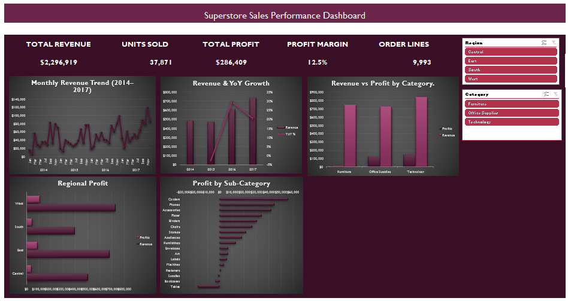

# Superstore Sales Performance Dashboard

## Project Overview
An interactive Excel dashboard that analyses four years of Superstore sales data (2014–2017).
I cleaned the raw data, summarised it with pivot tables, and built a dashboard with KPI cards,
trend charts and slicers that show revenue, profit and growth by region, category and sub-category.

## Dataset
- **Source:** Superstore Sales Dataset, Kaggle ([link](https://www.kaggle.com/datasets/vivek468/superstore-dataset-final))
- **Size:** 9,994 order lines × 21 columns (9,993 after cleaning)
- **Period:** January 2014 – December 2017
- **Fields:** order and ship dates, customer segment, region, state, city, category, sub-category, sales, quantity, discount, profit

## Tools
Microsoft Excel: Power Query import, Excel Tables, formulas, Pivot Tables, Pivot Charts, Slicers

## Data Cleaning
| Step | Issue / Action | Rows affected |
|---|---|---|
| 1 | Checked for blank or junk rows at the end of the data. None found | 0 |
| 2 | Removed an exact duplicate order line (all columns except Row ID matched) | 1 |
| 3 | Checked all columns for blank cells. None found | 0 |
| 4 | Restored leading zeros in Postal Code (e.g. `1852` → `01852`) | 438 |
| 5 | Replaced unreadable special characters in Product and Customer names | — |
| 6 | Applied date, currency and percentage formats | All |
| 7 | Added helper columns with formulas | 9,993 |

**Helper columns:**
- `Order Year` = `YEAR([@[Order Date]])`
- `Order Month` = `TEXT([@[Order Date]],"mmm")`
- `Ship Days` = `[@[Ship Date]]-[@[Order Date]]`
- `Profit Margin` = `IFERROR([@Profit]/[@Sales],0)`
- `Profit Status` = `IF([@Profit]<0,"Loss","Profit")`

## Analysis
Six pivot tables built from the cleaned `SalesData` table:
1. **KPI summary:** total revenue, units sold, total profit, order lines
2. **Monthly trend:** revenue by year and month, with **MoM %** (% Difference From previous month)
3. **Yearly trend:** revenue by year, with **YoY %** (% Difference From previous year)
4. **By category:** revenue vs profit
5. **By region:** revenue vs profit
6. **By sub-category:** profit, sorted from highest to lowest

## Dashboard Features
- **KPI cards:** Total Revenue, Units Sold, Total Profit, Profit Margin, Order Lines
- **Monthly Revenue Trend:** line chart, 2014–2017
- **Revenue & YoY Growth:** combo chart (columns + growth line on a secondary axis)
- **Revenue vs Profit by Category** and **by Region**
- **Profit by Sub-Category:** shows which products lose money
- **Slicers** for Region and Category, connected to every pivot, so one click filters the whole dashboard

## Key Insights
| Metric | Value |
|---|---|
| Total Revenue | $2,296,919 |
| Total Profit | $286,409 |
| Profit Margin | 12.5% |
| Units Sold | 37,871 |

1. **Steady growth after a dip.** Revenue fell 2.8% in 2015, then grew **29.5% in 2016** and **20.4% in 2017**.
2. **Strong seasonality.** September, November and December are the peak months every year, ahead of the holiday season.
3. **Furniture has a profit problem.** It brings in $741,718 in revenue, almost the same as Office Supplies ($719,047), but only **$18,463 in profit (2.5% margin)** compared with **$122,491 (17.0%)**.
4. **Three sub-categories lose money.** **Tables (−$17,725)**, **Bookcases (−$3,473)** and **Supplies (−$1,189)**. Copiers are the most profitable at $55,618.
5. **The West leads.** It has the highest revenue ($725,458) and a margin of 14.9%, above the company average. But West Furniture earns only a **4.6% margin**.

**Recommendation:** review pricing and discounts on Tables and Bookcases. Orders with high discounts (up to 80%) show large negative margins, so discounting is a likely cause worth investigating.

## How to Use
1. Download `Superstore_Sales_Dashboard.xlsx`.
2. Open the **Dashboard** sheet.
3. Click a **Region** or **Category** in the slicers to filter every KPI and chart.
4. Click the filter-clear icon (top right of each slicer) to reset.

## Repository Contents
| File | Description |
|---|---|
| `Superstore_Sales_Dashboard.xlsx` | Workbook: Data, Cleaning Log, Pivots and Dashboard sheets |
| `Sample - Superstore.csv` | Original raw dataset |
| `dashboard.png` | Dashboard screenshot |
